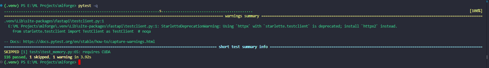
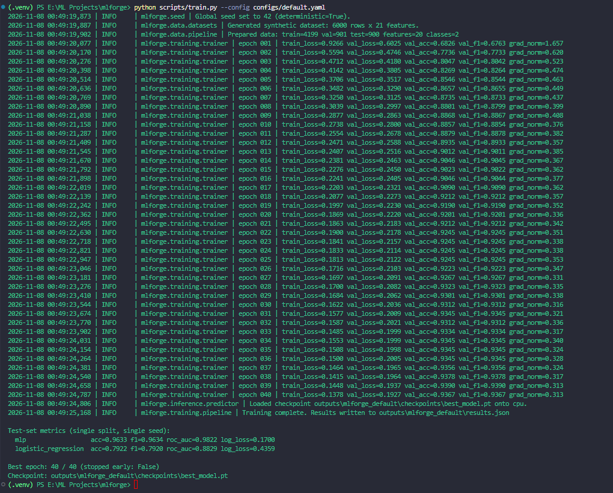
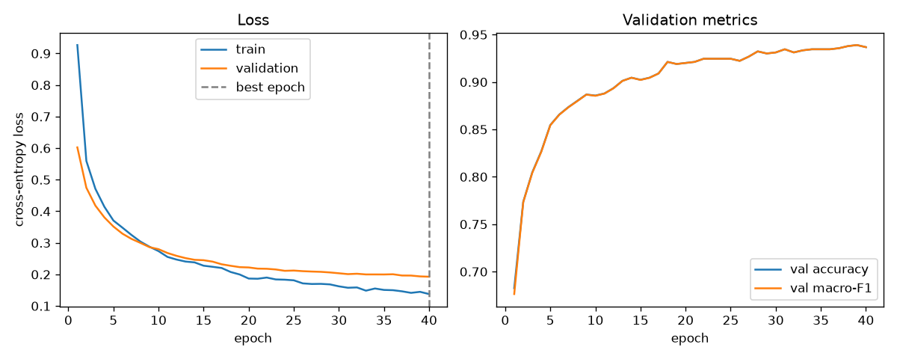
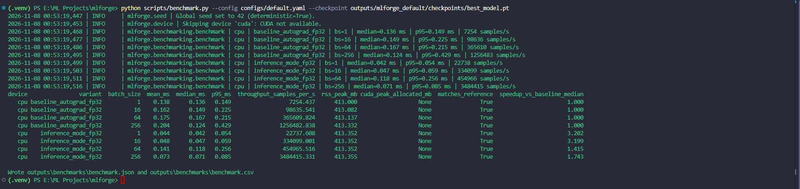
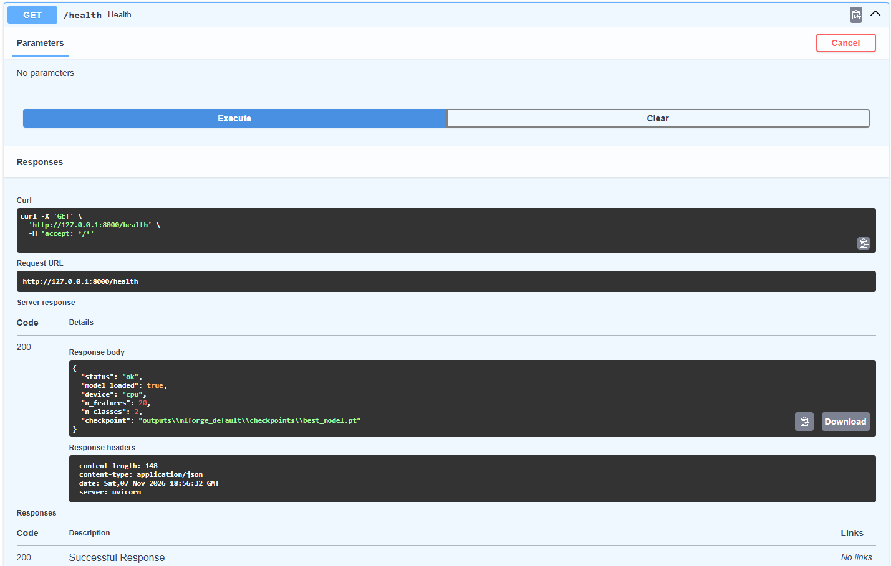
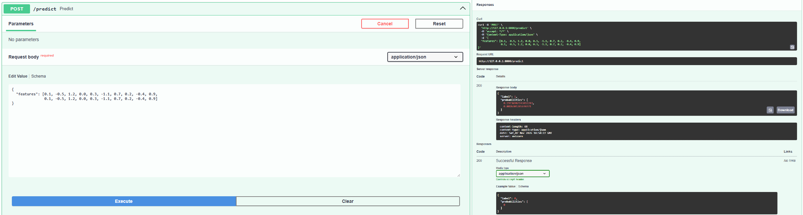
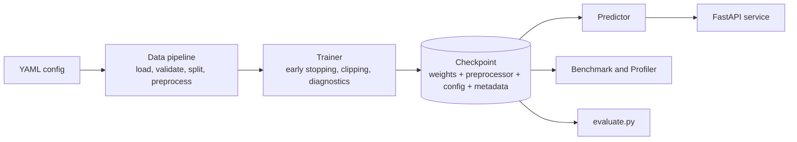

<div align="center">

# ⚙️ MLForge

### Reproducible ML Training, Inference & Performance Engineering Framework

*Train it. Verify it. Measure it. Serve it.*


</div>

---

## 📌 What is this?

MLForge is **not a model showcase. It is the engineering around a model.**

It is a modular Python framework that implements the full lifecycle of a tabular classifier: data validation, config-driven training, numerically careful computation, failure diagnostics, memory and latency measurement, and an HTTP inference service. Every claim in this README is backed by code in the repo and by output I produced by running it.

> **Honest scope:** the dataset is synthetic, the model is a small MLP, and results are from a single split and single seed. The point of the project is the *engineering practices*, not state-of-the-art accuracy.

---

## 🧭 Table of Contents

- [Highlights](#-highlights)
- [Results](#-results)
- [Architecture](#-architecture)
- [Quick Start](#-quick-start)
- [Usage](#-usage)
- [Engineering Details](#-engineering-details)
- [Bugs Found While Testing](#-bugs-found-while-testing)
- [Reproducibility](#-reproducibility)
- [Limitations](#-limitations)
- [Project Structure](#-project-structure)
- [Future Work](#-future-work)

---

## ✨ Highlights

| Area | What is implemented |
|---|---|
| 🧪 **Data engineering** | Synthetic or CSV data, validation, median imputation + standardisation fitted on the **train split only** (no leakage), stratified seeded splits |
| 🧠 **Models** | Configurable PyTorch MLP (hidden dims, activation, dropout) + scikit-learn Logistic Regression baseline, scored by the same metric code |
| 🔁 **Reproducible training** | Strict YAML config (typos rejected), centralised seeding, early stopping, gradient clipping, best-epoch restore, atomic checkpoints with run metadata |
| 🔢 **Numerical computing** | Naive vs stable softmax/sigmoid, logsumexp, stable cross-entropy, safe normalisation, manual gradient norm and clipping, tolerance-based comparison |
| 🩺 **Diagnostics** | NaN/Inf loss, exploding/vanishing gradients, shape/dtype/device mismatch, missing/corrupt checkpoint, OOM detection |
| 💾 **Memory** | Measured RSS (psutil, sampled peak) and CUDA peak, kept separate from *estimated* model memory |
| ⚡ **Performance** | Selectable inference variants, `torch.inference_mode`, optional CUDA AMP, OOM-adaptive batch size, benchmark harness, PyTorch Profiler |
| 🌐 **Serving** | FastAPI with Pydantic schemas, input validation, graceful degraded mode |
| ✅ **Testing** | 116 pytest tests, with implementations verified against independent references |

---

## 📊 Results

> All numbers below come from my own runs on a **Windows laptop, CPU only** (CUDA not available). They are single-run, single-seed measurements and will differ on other hardware.

### 1. Test suite



`116 passed, 1 skipped`. The skipped test needs CUDA and is skipped automatically without a GPU.

### 2. Training and predictive quality



Synthetic dataset: 6,000 rows, 20 features, 2 classes (4,199 train / 901 validation / 900 test).

| Model | Accuracy | F1 | ROC-AUC | Log-loss |
|---|---|---|---|---|
| **MLP (PyTorch)** | 0.9633 | 0.9634 | 0.9822 | 0.1700 |
| Logistic Regression (baseline) | 0.7922 | 0.7920 | 0.8829 | 0.4359 |

How to read this honestly:

- The comparison is on a **single split and single seed**, so the gap has not been tested against run-to-run variance.
- The data is synthetic (`make_classification`), so these numbers say nothing about real-world datasets.
- The best epoch was 40/40 and early stopping did not trigger, so longer training might improve the MLP further. I have not tested that.



### 3. Inference benchmark (CPU)



Same weights, same seeded inputs, warm-up discarded, forward pass only.

| Batch size | Baseline (autograd) median | `inference_mode` median | Median speed-up |
|---|---|---|---|
| 1 | 0.136 ms | 0.042 ms | 3.20× |
| 16 | 0.149 ms | 0.047 ms | 3.20× |
| 64 | 0.167 ms | 0.118 ms | 1.42× |
| 256 | 0.124 ms | 0.071 ms | 1.74× |

Peak throughput observed: about **3.48 M samples/s** (`inference_mode`, batch 256), versus about 1.26 M samples/s for the baseline.

Every CPU row reports `matches_reference = True`, meaning the outputs agree with a CPU fp32 reference within tolerance.

Caveats that matter:

- This was **one benchmark run**. The baseline median at batch 256 is lower than at batch 64, which suggests timing noise, so treat these ratios as indicative, not exact. The benchmark should be repeated to quantify variance.
- For a tiny MLP, absolute latencies are in fractions of a millisecond, where per-call overhead dominates.
- Timed region is the model forward pass only. Preprocessing and host-to-device transfer are excluded.

### 4. API serving

| | |
|---|---|
|  |  |
|  |  |

Endpoints: `GET /health`, `POST /predict`, `POST /predict/batch`. Invalid input returns a clear error: wrong feature count gives **422**, an oversized batch gives **413**, and a missing model gives **503**.

---

## 🏗️ Architecture



Design decisions worth noting:

- **Preprocessor state lives in the checkpoint** as plain lists, so serving applies exactly the training-time preprocessing with no pickled objects.
- **Checkpoints load with `weights_only=True`**, so they contain only tensors and plain Python types.
- **`inference` never imports `training`**, because checkpoint code lives at the package top level. This avoids circular imports.
- **GPU is always conditional.** CPU is the default, CUDA features activate only when available, and AMP is ignored on CPU with a warning.
- **MLflow is deliberately not used.** Each run writes a self-contained `results.json` with metadata, which is enough at this scale.

---

## 🚀 Quick Start

**Requirements:** Python 3.11+

```powershell
git clone https://github.com/<your-username>/mlforge.git
cd mlforge

python -m venv .venv
.\.venv\Scripts\Activate.ps1
python -m pip install --upgrade pip
pip install -e ".[dev]"
```

If PowerShell blocks activation: `Set-ExecutionPolicy -Scope Process -ExecutionPolicy Bypass`

Verify the install and run the tests:

```powershell
python -c "import mlforge, torch; print(mlforge.__version__, torch.__version__, torch.cuda.is_available())"
pytest -q
```

---

## 🕹️ Usage

### Train

```powershell
python scripts/train.py --config configs/quick_test.yaml --experiment-name smoke   # fast smoke run
python scripts/train.py --config configs/default.yaml                              # full run
```

Outputs go to `outputs/<experiment_name>/`:

| File | Content |
|---|---|
| `checkpoints/best_model.pt` | Best-epoch weights, optimizer state, architecture, preprocessor, config |
| `results.json` | Results grouped into `predictive_quality`, `numerical_correctness`, `inference_performance`, `resource_consumption`, plus training history |
| `training_history.png` | Loss and validation curves |
| `train.log` | Full log |

### Evaluate

```powershell
python scripts/evaluate.py --checkpoint outputs/mlforge_default/checkpoints/best_model.pt
```

### Benchmark and profile

```powershell
python scripts/benchmark.py --config configs/default.yaml --checkpoint outputs/mlforge_default/checkpoints/best_model.pt
python scripts/benchmark.py --config configs/default.yaml --dataloader --workers 0 2
python scripts/profile_inference.py --checkpoint outputs/mlforge_default/checkpoints/best_model.pt --batch-size 256 --steps 20
```

### Serve

```powershell
python scripts/serve.py --checkpoint outputs/mlforge_default/checkpoints/best_model.pt
```

Open `http://127.0.0.1:8000/docs` for interactive Swagger UI.

```powershell
$body = @{ features = @(0.1) * 20 } | ConvertTo-Json
Invoke-RestMethod -Method Post -Uri http://127.0.0.1:8000/predict -ContentType "application/json" -Body $body
```

`20` must equal the model's feature count. Missing values can be sent as `null` and are imputed with training medians.

### Python API

```python
from mlforge.inference import Predictor
from mlforge.config import InferenceConfig

predictor = Predictor.from_checkpoint(
    "outputs/mlforge_default/checkpoints/best_model.pt",
    InferenceConfig(device="cpu", batch_size=256),
)
print(predictor.predict_one([0.1] * predictor.n_features))
```

### Docker (optional, CPU image)

```powershell
docker build -t mlforge .
docker run --rm -p 8000:8000 -v "${PWD}\outputs\mlforge_default\checkpoints:/app/model:ro" mlforge
```

---

## 🔬 Engineering Details

<details>
<summary><b>🔢 Numerical computing: naive vs stable</b></summary>

| Naive | Stable | Why it matters |
|---|---|---|
| `naive_softmax` | `stable_softmax` | `exp(x)` overflows for large inputs, giving inf/inf = NaN |
| `naive_sigmoid` | `stable_sigmoid` | `exp(-x)` overflows for large negative x |
| softmax then log | `stable_log_softmax_t` | Avoids `log(0)` from underflowed probabilities |
| plain divide | `safe_normalize` | Zero vectors map to zeros, not NaN |

Gradient clipping is implemented manually and tested against `torch.nn.utils.clip_grad_norm_`. Matrix multiplication is checked against a loop reference, and a manual linear layer against `nn.Linear`.
</details>

<details>
<summary><b>🩺 Diagnostics and failure handling</b></summary>

| Failure | Behaviour |
|---|---|
| NaN / Inf loss | `NumericalInstabilityError` naming the epoch and step, with likely causes |
| Exploding / vanishing gradients | Per-layer report, logged as a warning; inspected **before** clipping so clipping cannot hide an explosion |
| Shape, dtype, device mismatch | Specific `DataValidationError` / `DeviceError` |
| Missing or corrupt checkpoint | `CheckpointError` with the original cause chained |
| Out of memory | Inference halves the batch size and retries (when enabled) |

Errors are never silently swallowed.
</details>

<details>
<summary><b>💾 Measured vs estimated memory</b></summary>

| Quantity | Kind |
|---|---|
| Process RSS, start/end/peak | **Measured** (peak sampled every 5 ms) |
| CUDA peak allocated | **Measured** (CUDA only) |
| Parameter count | Exact |
| Parameter and buffer bytes | **Estimated** |
| Forward activation memory | **Estimated** (lower-bound style) |

RSS covers the whole process, so deltas for small models are often dominated by noise.
</details>

<details>
<summary><b>⚡ Optimisations and when they help</b></summary>

| Technique | When it helps | Caveat |
|---|---|---|
| Batch inference | Amortises per-call overhead | Higher per-call latency and memory |
| `torch.inference_mode()` | Skips autograd bookkeeping | Gain varies with model size and hardware |
| CUDA AMP (fp16) | Larger models on tensor-core GPUs | Slight output differences; CUDA only |
| Pinned memory | Faster host-to-GPU copies | Enabled only when targeting CUDA |
| DataLoader workers | Heavy loading/IO | Often slower for small in-memory tensors |

None of these are assumed to help; the benchmark measures them.
</details>

<details>
<summary><b>✅ Test strategy</b></summary>

Correctness is established against independent references rather than self-consistency:

- Stable softmax and cross-entropy vs PyTorch
- Loop matmul vs BLAS
- Manual gradient clipping vs `clip_grad_norm_`
- Metrics vs hand-computed values
- Checkpoint round-trip vs the in-memory model
- Same-seed runs vs repeated training

Benchmark tests assert structure and invariants only, never speed. CUDA-specific tests skip automatically without a GPU.
</details>

---

## 🐛 Bugs Found While Testing

The code was written first and run afterwards. Running the test suite on a recent Python and library stack surfaced four real issues, all fixed:

| # | Issue | Root cause | Fix |
|---|---|---|---|
| 1 | Checkpoint failed to load | `torch.__version__` is a `TorchVersion` object, which `weights_only=True` rejects | Store `str(torch.__version__)` |
| 2 | `roc_auc` came back as `NaN` instead of `None` | Newer scikit-learn returns NaN with a warning instead of raising | Convert NaN to `None`, so JSON stays valid |
| 3 | Test crashed on a nested list | `pytest.approx` does not support nested structures | Use `np.testing.assert_allclose` |
| 4 | `tests` package not importable | Project root was missing from `sys.path` | Set `pythonpath = ["."]` in pytest config |

---

## 🔁 Reproducibility

- `set_global_seed` seeds Python, NumPy and PyTorch, and (with `deterministic: true`) requests deterministic algorithms. Splits are stratified and seeded, and DataLoader shuffling uses a dedicated seeded generator.
- Repeated runs are expected to match on the **same machine, same library versions and same device type**. The test suite checks this on CPU.
- Exact reproducibility is **not guaranteed** across different hardware, OS, library versions, thread counts or non-deterministic GPU kernels.
- Benchmark timings depend on hardware and background load. Compare rows only within one run.

---

## ⚠️ Limitations

- Synthetic data, single split, single seed. No cross-validation or confidence intervals, so model differences may fall within run-to-run variance.
- Minimal preprocessing: numeric features, median imputation, standardisation.
- Benchmarks time the forward pass only and were run on CPU. GPU paths are implemented but I have not measured them.
- The API serialises model access with a lock; it is not a high-throughput serving design.
- Only the MLP is checkpoint-restorable. Adding a model means extending `checkpointing.restore_model`.

---

## 📁 Project Structure

```
mlforge/
├── configs/          default.yaml, quick_test.yaml
├── docs/             architecture, numerics, performance, debugging, AI-assisted development
├── screenshots/      images used in this README
├── scripts/          train, evaluate, benchmark, profile_inference, serve
├── src/mlforge/
│   ├── config.py  seed.py  device.py  checkpointing.py  exceptions.py  logging_utils.py
│   ├── data/            datasets, validation, preprocessing, splits, loaders, pipeline
│   ├── models/          mlp, baseline
│   ├── numerics/        stability, linalg, gradients
│   ├── memory/          profiler
│   ├── diagnostics/     checks
│   ├── evaluation/      metrics, comparison
│   ├── training/        trainer, early_stopping, reporting, pipeline
│   ├── inference/       predictor
│   ├── benchmarking/    benchmark, profiling
│   └── api/             app, schemas
├── tests/            116 pytest tests
├── Dockerfile
├── pyproject.toml
└── requirements.txt
```

More detail in [`docs/`](docs/): architecture, numerical computing, performance engineering, debugging guide, and AI-assisted development workflow.

---

## 🔮 Future Work

- Repeated-seed runs and cross-validation to put error bars on the model comparison
- Repeated benchmark runs to report latency variance
- Measured CPU vs GPU comparison on CUDA hardware
- `torch.compile` / quantisation experiments with accuracy checks
- Additional model families and categorical feature support
- Request batching in the API

---

## 🤖 AI-Assisted Development

This project was built with an AI coding assistant. AI output was treated as *suggested*, not *correct*: it was reviewed, run, and validated through tests and real execution, which is how the bugs above were caught. The workflow is documented in [`docs/ai_assisted_development.md`](docs/ai_assisted_development.md).

---

<div align="center">

**Built to demonstrate reproducible, measurable, debuggable ML engineering.**

</div>
